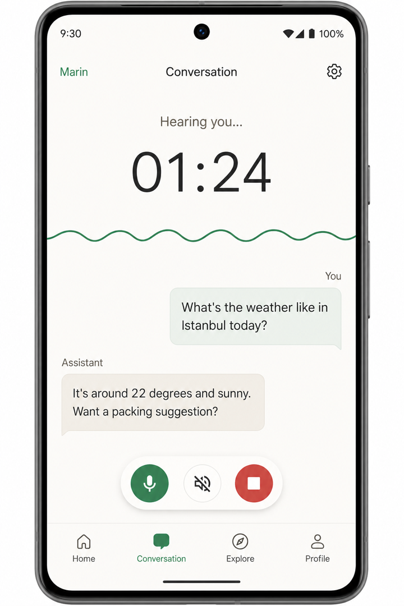
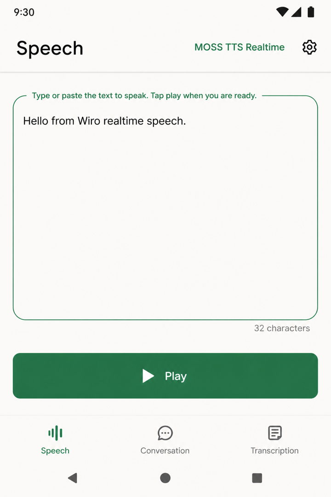

<div align="center">


# Wiro Realtime for Kotlin

**Official Kotlin / Jetpack Compose example for live voice AI on
[Wiro](https://wiro.ai) — speech-to-speech conversation, realtime
transcription, and text-to-speech**

[](https://kotlinlang.org)
[](#requirements)
[](#requirements)
[](LICENSE)

[Docs](https://wiro.ai/docs) · [Models](https://wiro.ai/models) ·
[Dashboard](https://wiro.ai/panel) ·
[Create Project](https://wiro.ai/panel/project/new)

</div>

## What's inside

Three realtime audio flows, each a tab in the app, each backed by a
live Wiro model over one WebSocket protocol:

| Flow | Model | What it does |
| --- | --- | --- |
| Conversation | [`openai/gpt-realtime-mini`](https://wiro.ai/models) | Full-duplex voice chat with barge-in |
| Transcription | [`mistralai/voxtral-mini-4b-realtime-2602`](https://wiro.ai/models) | Live speech-to-text as you talk |
| Speech | [`openmoss/moss-tts-realtime`](https://wiro.ai/models) | Streaming text-to-speech playback |

The chrome is Material 3 Expressive, all system components:
`Scaffold`, `TopAppBar`, `NavigationBar`, a floating toolbar for
the live call controls, a wavy progress line driven by the real
microphone level, chat-bubble transcripts, and the Expressive
loading shape while connecting. Light and dark Wiro themes follow
the system. There is no custom orb, wave, or tab bar.

## Screenshots

<p align="center">
  
  
  
  
</p>

## Features

- Live speech-to-speech conversation with voice activity detection,
  barge-in, and a noise gate
- Realtime microphone transcription with streaming partial results
- Streaming text-to-speech with bounded PCM playback
- One `AudioRecord` / `AudioTrack` graph for capture and playback,
  so the platform echo canceller (AEC) actually works
- Signed REST Run requests and the full Wiro realtime WebSocket
  protocol
- Bounded capture/playback queues, safe PCM overflow shedding, audio
  route and interruption handling
- Cross-feature guard so two tabs never hold the microphone at once
- Automatic reconnect to the same task on socket drops, with a
  bounded restart budget
- Session lifecycle covered by JVM unit tests and fakes — no device
  needed to verify the plumbing

## Requirements

- JDK 17
- Android Studio (or the Android SDK) with compileSdk 37
- A **physical** Android phone on API 26 or later — the emulator
  microphone is not a usable voice path
- A [Wiro project and API key](https://wiro.ai/panel/project/new)

## Run

Copy the credential template and set the key:

```sh
cp secrets.properties.example secrets.properties
```

Edit `secrets.properties`:

```
WIRO_API_KEY=YOUR_API_KEY
WIRO_API_SECRET=
```

`WIRO_API_SECRET` is only for signature-based Wiro projects. Leave
it empty for API-key-only projects. The secrets file is gitignored.

Then open the project in Android Studio, pick a physical phone, and
run the `app` configuration. Or:

```sh
./gradlew :app:installDebug
```

Alternatively, leave `secrets.properties` empty and set
`WIRO_API_KEY` (and optionally `WIRO_API_SECRET`) in the process
environment when you assemble. Environment values win over the
file.

Launch fails fast when `WIRO_API_KEY` is missing.

> **Credentials warning:** values from `secrets.properties` are
> compiled into the debug binary via `BuildConfig`. Environment
> values are for local runs only. Never distribute builds containing
> real credentials — production apps should authenticate through a
> controlled backend or a short-lived credential flow.

## Make it yours

[`app/src/main/java/ai/wiro/realtime/app/ConversationConfig.kt`](app/src/main/java/ai/wiro/realtime/app/ConversationConfig.kt)
holds the persona, the voice, and the model.
Editing that one file is the whole of turning this example into a
product.

```kotlin
const val PERSONA = "...who the assistant is..."
const val VOICE = "marin"
```

Common changes:

- **Give the assistant a job** — rewrite `PERSONA`.
- **Change the voice** — set `VOICE` to any option the model catalog
  lists.
- **Tune the engineering parameters** — `parameters` overrides the
  catalog defaults for turn detection, audio formats, and rates.
- **Ship only the conversation** — delete
  `app/src/main/java/ai/wiro/realtime/ui/transcription/`,
  `app/src/main/java/ai/wiro/realtime/ui/speech/`,
  `app/src/main/java/ai/wiro/realtime/services/transcription/`,
  and
  `app/src/main/java/ai/wiro/realtime/services/speech/`
  (plus their `app/src/test` mirrors), then remove the two
  destinations from
  `app/src/main/java/ai/wiro/realtime/ui/home/RealtimeHomeView.kt`.
  Shared layers under `models/`, `networking/`, `auth/`,
  `realtime/`, and `audio/` are untouched.

## How a conversation runs

```text
REST:      https://api.wiro.ai/v1
WebSocket: wss://socket.wiro.ai/v1
Run:       POST /Run/{owner}/{model}
```

1. `POST /Run/{owner}/{model}` returns a task id and a task token.
2. A WebSocket opens and subscribes with
   `{ "type": "task_info", "tasktoken": "..." }`.
3. After `task_stream_ready`, 20 ms PCM chunks stream up as
   `UTF8(tasktoken + "|") + pcm_bytes`; audio and transcripts stream
   back.
4. `task_session_end` closes the session — sent by the app on leave,
   or by the server when the task goes quiet.

Audio is signed 16-bit PCM, 24 kHz, mono, little-endian on both
sides.

Authentication is `x-api-key` alone, or `x-api-key` + `x-nonce` +
`x-signature` where the signature is
`HMAC-SHA256(key = API_KEY, message = API_SECRET + NONCE)`.

## Project layout

```text
app/src/main/java/ai/wiro/realtime/
  app/            entry config, ConversationConfig, theme
  models/         catalog, parameters, run result
  networking/     HTTP, endpoints, Run launcher
  auth/           credentials, nonce, headers
  realtime/       socket, session, framing
  audio/          PCM, graph, session
  services/       Conversation / Transcription / Speech
  ui/             home / conversation / transcription / speech / shared
app/src/test/java/ai/wiro/realtime/
                  mirrors the app; support/ holds fakes
secrets.properties.example   credential template (copy locally)
```

`models/`, `networking/`, `auth/`, `realtime/`, and `audio/` have
no dependency on Compose or any screen service and cover the whole
Wiro integration — they are the part worth lifting into your own
app.

## Tests

```sh
WIRO_API_KEY=test ./gradlew spotlessApply detekt \
  :app:testDebugUnitTest
```

Tests mirror `ai.wiro.realtime` and ship fakes for audio, network,
and the socket, so the entire session lifecycle runs without a
device. CI runs `spotlessCheck`, `detekt`, and the unit tests on
every push and pull request.

## Contributing

Read [`CONTRIBUTING.md`](CONTRIBUTING.md) before opening a pull
request. Security problems go to [`SECURITY.md`](SECURITY.md), not
to a public issue.

## Documentation

- [Wiro documentation](https://wiro.ai/docs)
- [Available models](https://wiro.ai/models)
- [Swift counterpart](https://github.com/wiroai/Swift-Realtime)
- [React Native counterpart](https://github.com/wiroai/ReactNative-Realtime)
- [Dart counterpart](https://github.com/wiroai/Dart-Realtime)

## License

MIT

---

<div align="center">


**Built with 💚 by the Wiro team**

[wiro.ai](https://wiro.ai) · [GitHub @wiroai](https://github.com/wiroai)

</div>
